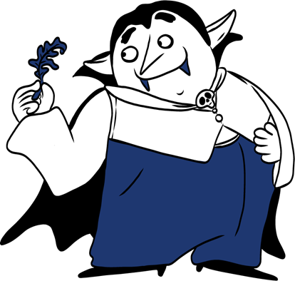

I'm a final year Ph.D. student in the [Data and Web Science Group](https://www.uni-mannheim.de/dws) at the University of Mannheim, under the supervision of Professor Heiner Stuckenschmidt. Previously, I was a research scientist at [NEC Laboratories Europe](https://www.neclab.eu/). 

My primary research focus revolves around temporal Knowledge Graphs. Specifically, I am intrigued by temporal knowledge graph forecasting and the evaluation of methods in this research domain. 

Besides research, I like music, food, and boats.

## News

### 🎸 Festival Lineup Forecasting @ AKBC 2026
* Our paper *A temporal knowledge graph for Music Festival Lineup Forecasting* was accepted at the 11th Workshop on Automated Knowledge Base Construction (AKBC 2026) in Budapest. 
* Who will play at next year's festival? Music festival lineups emerge from complex relationships among artists, genres, releases, labels, and past performances, which makes them a natural fit for TKG forecasting.
* [Paper](https://aclanthology.org/2026.akbc-1.4/), [Poster](https://www.akbc.ws/2026/presentations/posters/poster_Julia_Gastinger.pdf), [Code](https://github.com/JuliaGast/festival-lineup-tkg)

More Infos

* We build a TKG covering 380 festivals over 55 years, with more than 90K festival performance quadruples, plus data on festivals, artist tours and artist metadata.
* We frame lineup prediction as temporal link prediction between artists and festivals. We evaluate six TKG forecasting models and compare them with zero-shot LLMs.
* This complements existing TKG benchmarks by grounding evaluation in a concrete, real-world application domain.
* Team: Julia Gastinger, Thilo Dieing, Christian Meilicke, Heiner Stuckenschmidt

### 🧛‍♂️ CountTRuCoLa @ ISWC 2026 
* Our paper *CountTRuCoLa: Rule Learning for Interpretable Temporal Knowledge Graph Forecasting* was accepted at The 25th International Semantic Web Conference
* We show that a lightweight, interpretable model can achieve predictive accuracy competitive with, and in some cases surpassing, more complex neural models while maintaining scalability.
* [Paper](https://arxiv.org/abs/2509.09474), [Code](https://github.com/JuliaGast/counttrucola)

More Infos

* We address the task of temporal knowledge graph forecasting by introducing a fully interpretable method based on symbolic rules. 
* Our approach learns four simple rule types, including temporal rules with confidence functions that combine both recency and frequency.
* Evaluated on nine datasets, our method achieves performance that is competitive with state-of-the-art models and outperforms the majority of them, while providing fully interpretable predictions. 
* Moreover, our approach remains functional on very large datasets, where other methods encounter runtime or memory failures.
* Team: Julia Gastinger, Christian Meilicke, Heiner Stuckenschmidt
* Shout out to [Ulla Menzenbach](https://www.instagram.com/frankies.onion) for illustrating our CountTRuCoLa 

### 🔬 Temporal Knowledge Graph Forecasting under Distribution Shifts: A Synthetic Evaluation @ 23rd International Workshop on Mining and Learning with Graphs (ECML PKDD) 2026
* Our paper was accepted at the International Workshop on Mining and Learning with Graphs (ECML PKDD)
* [Paper](https://arxiv.org/abs/2607.09232), [Code](https://github.com/konradoezdemir/shifting-tkg)
* Shout out to Konrad for leading this project. 

More Infos

* In this paper, we study TKG forecasting under controlled shift environments using a synthetic TKG generator that encodes three temporal and structural properties -- recurrence, homophily, and periodicity -- as data-generating mechanisms. 
* This allows us to evaluate seven forecasting architectures under stationary and shifting regimes. 

* Team: Konrad Özdemir, Julia Gastinger, Lukas Kirchdorfer, Heiner Stuckenschmidt

### 🛰️ TENET Satellite @ NetSci 2026
* At [TENET](https://tenet-satellite.github.io/website.github.io) (TEmporal NETworks), we invite contributions that advance temporal network theory, methods, and applications. 
* The satellite brings together researchers from diverse fields to explore how networks change, adapt, and respond to internal and external forces. 

### 👩🏽‍🔬 Girls' Day 2026 at University of Mannheim
* Girls' Day is a annual career day in Germany where girls visit universities and companies to explore STEM fields. 

More Infos

* Find the materials (German) on [GitHub](https://github.com/JuliaGast/girlsday25_tiktok)
* Together with colleagues, I organized a hands-on session at the University of Mannheim introducing high-school students to how recommendation algorithms behind platforms like TikTok work, and their societal implications, from filter bubbles to manipulation.

###  Temporal Graph Learning Workshop @ KDD 2025
* The third edition of our [Temporal Graph Learning workshop](https://sites.google.com/view/tgl-workshop-2025/) happened at KDD 2025 - yeah!
* Team: Farimah Poursafaei, Shenyang Huang, Julia Gastinger, Daniele Zambon, Andrea Cini, Jacob Chmura, Reihaneh Rabbany, Michael Bronstein

###   Top Reviewer Award @ LOG 2024 
* I'm honored to be recognized as one of the top reviewers at the [Learning on Graphs Conference 2024](https://logconference.org/).
* Huge thanks to the organizers for putting together such an awesome event.

###   Dynamic Representations of Global Crises @ LOG 2024 
Can we forecast trade sanctions? Our LoG paper builds a temporal knowledge graph that links worldwide conflict events (ACLED) with trade policy interventions (Global Trade Alert), and applies TKG forecasting methods to it.
* [Paper](https://openreview.net/forum?id=LipaBQwFeZ), [Code](https://github.com/JuliaGast/GTA_ACLED_TKG/tree/main), [Poster](https://openreview.net/attachment?id=LipaBQwFeZ&name=poster)

More Infos

* Full title: *Dynamic Representations of Global Crises: A Temporal Knowledge Graph For Conflicts, Trade and Value Networks*, accepted at the Learning on Graphs Conference 2024.
* The TKG has daily snapshots for 2023, with countries, economic sectors and conflict actors connected by 19 relation types.
* We compare it to existing TKG datasets and analyze the model predictions across conflict and trade relations.
* Team: Julia Gastinger, Timo Sztyler, Nils Steinert, Sabine Gruender-Fahrer, Michael Martin, Anett Schuelke, Heiner Stuckenschmidt

###  TGB 2.0 @ NeurIPS 2024
* [TGB 2.0](https://tgb.complexdatalab.com/) extends the Temporal Graph Benchmark to multi-relational graphs, with large and diverse datasets for temporal knowledge graphs and temporal heterogeneous graphs (NeurIPS Datasets and Benchmarks Track).
* [Paper](https://arxiv.org/abs/2406.09639), [Website](https://tgb.complexdatalab.com/), [Code](https://github.com/shenyangHuang/TGB)

More Infos

* Our goal is to provide a realistic, reproducible, and robust evaluation platform for machine learning on temporal multi-relational graphs.
* Key findings: relation information is needed for high performance, simple heuristic baselines are often competitive with complex methods, and most methods fail to run on our largest datasets.
* Team 🙌: Julia Gastinger^, Shenyang Huang^, Michael Galkin, Erfan Loghmani, Ali Parviz, Farimah Poursafaei, Jacob Danovitch, Emanuele Rossi, Yiannis Koutis, Heiner Stuckenschmidt, Reihaneh Rabbany, Guillaume Rabusseau (^equal contribution)

###  A Baseline for TKG Forecasting @ IJCAI 2024
* How far do you get by just assuming history repeats itself? Pretty far: our IJCAI paper proposes a simple recurrency-based baseline for TKG forecasting that beats state-of-the-art methods on 3 out of 5 commonly used datasets.
* [Paper](https://www.ijcai.org/proceedings/2024/444), [Code](https://github.com/nec-research/recurrency_baseline_tkg), [Supplementary Material](https://github.com/nec-research/recurrency_baseline_tkg/blob/master/supplementary_material.pdf)

more

* Full title: *History repeats itself: A Baseline for Temporal Knowledge Graph Forecasting*
* The baseline predicts future facts from how often and how recently they occurred in the past. It is fast, simple, and fully interpretable.
* It gives a sanity check for new TKG forecasting methods: complex models should at least beat it.
* Team: Julia Gastinger, Christian Meilicke, Federico Errica, Timo Sztyler, Anett Schuelke, Heiner Stuckenschmidt

          

###  Internship in Montréal! 
* In spring 2024, I did a 2-month research internship at [Mila - Quebec AI Institute](https://mila.quebec/en/) and University of Montréal, supervised by Prof. Guillaume Rabusseau.
* During the internship I worked on benchmarking temporal knowledge graph forecasting Methods. 
* Further, I focused on eating as many different Poutines as possible - yeahi.

###    Temporal Graph Learning Workshop @ NeurIPS 2023 
* We organized the second edition of the [Temporal Graph Learning Workshop](https://sites.google.com/view/tglworkshop-2023/home) @ NeurIPS 2023 in New Orleans
* Team: Farimah Poursafaei, Shenyang Huang, Kellin Pelrine, Emanuele Rossi, Julia Gastinger, Reihaneh Rabbany, Michael Bronstein

###  Comparing Apples and Oranges? @ ECML PKDD 2023
* Evaluation settings matter: TKG forecasting papers use inconsistent evaluation protocols, which makes their reported results hard to compare. Our ECML PKDD paper uncovers these inconsistencies and re-evaluates existing methods under one unified protocol.
* [Paper](https://github.com/JuliaGast/JuliaGast.github.io/blob/master/files/gastinger_evaluation_paper_TKG.pdf), [Code](https://github.com/nec-research/TKG-Forecasting-Evaluation), [Supplementary Material](https://github.com/nec-research/TKG-Forecasting-Evaluation/blob/main/paper_supplementary_material.pdf)

More Infos

* Full title: *Comparing Apples and Oranges? On the Evaluation of Methods for Temporal Knowledge Graph Forecasting*
* In this work we focus on the evaluation of TKG Forecasting models: we highlight existing issues, propose a unified evaluation protocol, and apply it to re-evaluate state-of-the-art models.
* Under a consistent evaluation, results and rankings of methods can change compared to what was originally reported.
* Team: Julia Gastinger, Timo Sztyler, Lokesh Sharma, Anett Schuelke, Heiner Stuckenschmidt

## Temporal Graph Learning Reading Group

If you share an interest in Temporal Graph Learning, I invite you to check out and join our [Temporal Graph Reading Group](https://shenyanghuang.github.io/rg.html).

More Infos

 We meet every Wednesday at 9 am EDT (3 pm CST) on Zoom, where authors of insightful and recent Temporal Graph Learning Papers present their work. The reading group is organized by Shenyang (Andy) Huang, Emma Kondrup, Farimah Poursafaei, and myself.

## Publications

### Most Recent Publications:
Julia Gastinger, Thilo Dieing, Christian Meilicke, Heiner Stuckenschmidt
[A Temporal Knowledge Graph for Music Festival Lineup Forecasting](https://aclanthology.org/2026.akbc-1.pdf#page=36). In Proceedings of the 11th Workshop on Automated Knowledge Base Construction (AKBC), 2026.

Julia Gastinger, Christian Meilicke, Heiner Stuckenschmidt [CountTRuCoLa: Rule Learning for Interpretable Temporal Knowledge Graph Forecasting](https://arxiv.org/abs/2509.09474). In International Semantic Web Conference (ISWC), 2026

Konrad Özdemir, Julia Gastinger, Lukas Kirchdorfer, Heiner Stuckenschmidt [Temporal Knowledge Graph Forecasting under Distribution Shifts: A Synthetic Evaluation](https://arxiv.org/abs/2607.09232). In 23rd International Workshop on Mining and Learning with Graphs (ECML PKDD), 2026.

Julia Gastinger, Timo Sztyler, Nils Steinert, Sabine Gruender-Fahrer, Michael Martin, Anett Schuelke, Heiner Stuckenschmidt [Dynamic Representations of Global Crises: A Temporal Knowledge Graph For Conflicts, Trade and Value Networks](https://openreview.net/forum?id=LipaBQwFeZ). In Learning on Graphs Conference (LoG), Virtual Event, 2024.

Julia Gastinger^, Shenyang Huang^, Michael Galkin, Erfan Loghmani,
Ali Parviz, Farimah Poursafaei, Jacob Danovitch, Emanuele Rossi, Yiannis Koutis, Heiner Stuckenschmidt, Reihaneh Rabbany, Guillaume Rabusseau  (^equal contribution) [TGB 2.0: A Benchmark for Learning on Temporal Knowledge Graphs and Heterogeneous Graphs @ NeurIPS 2024](https://arxiv.org/abs/2406.09639). In NeurIPS Datasets and Benchmarks Track, Vancouver, Canada, 2024.

Julia Gastinger, Christian Meilicke, Federico Errica, Timo Sztyler, Anett Schuelke, Heiner Stuckenschmidt.
[History repeats itself: A Baseline for Temporal Knowledge Graph Forecasting](https://github.com/nec-research/recurrency_baseline_tkg/blob/master/main.pdf). In IJCAI, Jeju, South-Korea, 2024.

### Google Scholar:
For a full list of publications please visit my google scholar: [Link](https://scholar.google.com/citations?user=UgrQkB4AAAAJ&hl=en&oi=ao)

